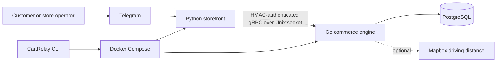

# CartRelay

**A self-hosted ecommerce platform with a Telegram storefront.**

Customers browse products, build a cart, request a delivery quote, and place orders in Telegram. Store operators manage inventory, promotions, orders, and delivery assignments through the same bot. A Go backend keeps business rules and PostgreSQL data separate from the Python storefront.

Previously **Logistics Engine Core**. This is an experimental open-source project; review and test it for your store before accepting real orders.

## Features

| Customers | Store operators |
| --- | --- |
| Categories, search, product photos, and availability | Catalog editing, stock adjustments, and CSV import |
| Persistent carts and delivery quotes | Order statuses, notes, and issue resolution |
| Promo codes and loyalty points | Promotion management and loyalty adjustments |
| Profiles, saved addresses, order history, and reordering | Warehouses, driver records, and delivery assignments |
| Order notifications and cancellation | Revenue, order volume, low-stock reports, and audit logs |

The engine calculates taxes and delivery fees, validates stock, and uses idempotency keys against duplicate order submissions. Optional Mapbox driving-distance quotes fall back to Haversine estimates.

### Current boundaries

- Telegram is the storefront; there is no browser storefront or web admin dashboard.
- Checkout records orders. Online payments, refunds, and payment reconciliation are not implemented.
- Customer-facing amounts currently use **LKR**; multiple currencies are not supported.
- The language selector saves a preference; the interface is currently English.
- `/support` provides guidance and `/report` records an order issue; there is no live support inbox.
- Profile removal clears the profile and saved addresses. Orders can retain identifiers and delivery details; this is not complete personal-data erasure.
- Default health checks verify socket existence, not a complete purchase or Telegram connectivity.

## Architecture



| Directory | Responsibility |
| --- | --- |
| `bot/` | Customer/admin conversations, keyboards, cart client, notifications |
| `engine/` | Catalog, orders, pricing, auth, migrations, delivery calculations |
| `supervisor/` | Deployment CLI, logs, maintenance, optional signed update tooling |
| `deploy/` | Source deployment stack and systemd service |
| `local_test/` | Development Compose stack |

The public gRPC service remains `logistics.LogisticsEngine` for compatibility. See [architecture](docs/ARCHITECTURE.md).

## Run a development store

You need Docker with Compose v2 and a test Telegram bot created through `@BotFather`. Obtain your numeric Telegram ID for the first administrator.

```bash
git clone https://github.com/pamidu1540/cartrelay.git
cd cartrelay
```

Supply settings through your environment or an ignored `local_test/.env` file using your secret manager. [The example](local_test/.env.example) lists required names. Never commit real credentials. Use at least 32 random bytes for `INTERNAL_TOKEN` and a strong database password.

```bash
docker compose -f local_test/docker-compose.yml --env-file local_test/.env up --build -d
docker compose -f local_test/docker-compose.yml --env-file local_test/.env logs -f engine bot
```

When injecting settings into your shell, omit `--env-file`. Set `POSTGRES_USER`, `POSTGRES_DB`, `POSTGRES_PASSWORD`, `INTERNAL_TOKEN`, `TELEGRAM_BOT_TOKEN`, and `ADMIN_USER_IDS`. Containers receive only the settings they need.

### Set up the store

1. Open the bot and complete `/start` profile/address setup.
2. As the seeded administrator, add a warehouse through `/warehouses` and admin controls.
3. Add products through the admin catalog controls, including prices and stock.
4. Review `/settings`, delivery charges, tax, loyalty rates, and cancellation rules.
5. Use another customer account to browse `/catalog`, add to `/cart`, and place a test order.
6. Verify `/allorders`, status changes, notifications, and delivery assignments.

```bash
docker compose -f local_test/docker-compose.yml --env-file local_test/.env down
```

Stopping preserves the database volume. `down -v` deletes it.

## Deploy on Linux

Build from a reviewed source checkout:

```bash
docker compose -f deploy/docker-compose.yml --env-file /secure/path/cartrelay.env up --build -d
```

Use [deploy/.env.example](deploy/.env.example) as a reference. Keep the actual environment file outside the checkout with restrictive permissions. Docker administrators can inspect container environment variables.

An optional source installer supports a fresh Ubuntu/Debian x64 host with Docker Compose, Go 1.25+, Python 3, `python3-cryptography`, OpenSSL, and systemd already installed:

```bash
sudo bash install.sh
sudo cartrelay status
```

It builds the checkout, prompts for credentials, encrypts configuration, and installs the CLI and systemd service. It refuses to overwrite an existing deployment. See [deployment, backups, updates, and uninstall](docs/DEPLOYMENT.md).

## Development

Go/Python development requires Go 1.25+, Python 3.13+, and `uv`. Windows users can run `.\init-dev.ps1` to install Task and development tools.

```bash
task setup-python
task lint
task test
task build
```

See [CONTRIBUTING.md](CONTRIBUTING.md) for direct commands and API changes, and [SECURITY.md](SECURITY.md) for vulnerability reporting. Database integration tests require a disposable `TEST_DATABASE_URL`.

## License

[MIT](LICENSE). Telegram and optional Mapbox usage remain subject to their provider terms. This independent project does not imply provider endorsement.
